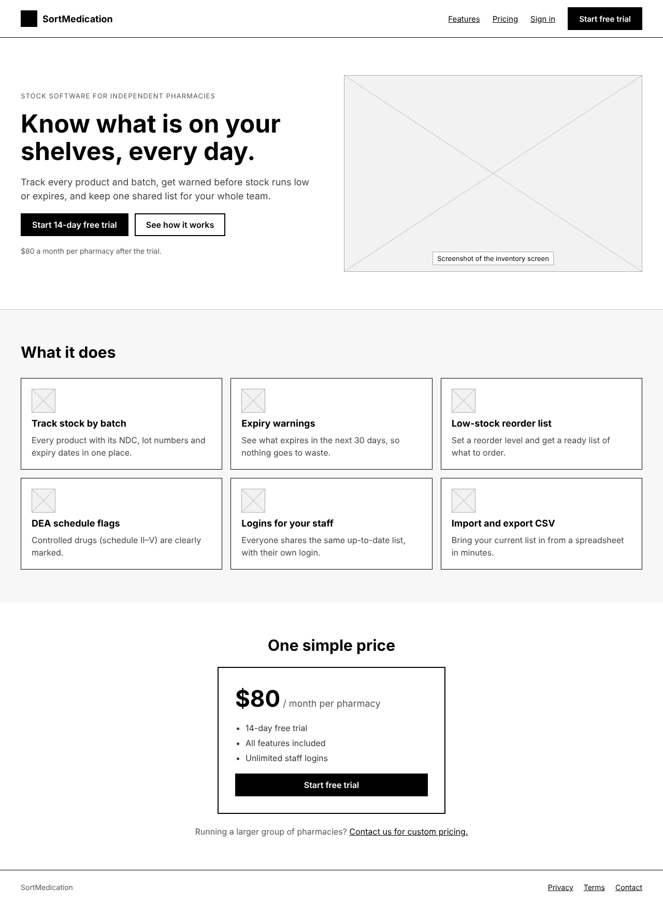
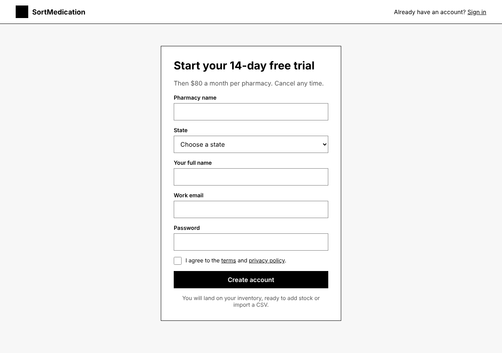
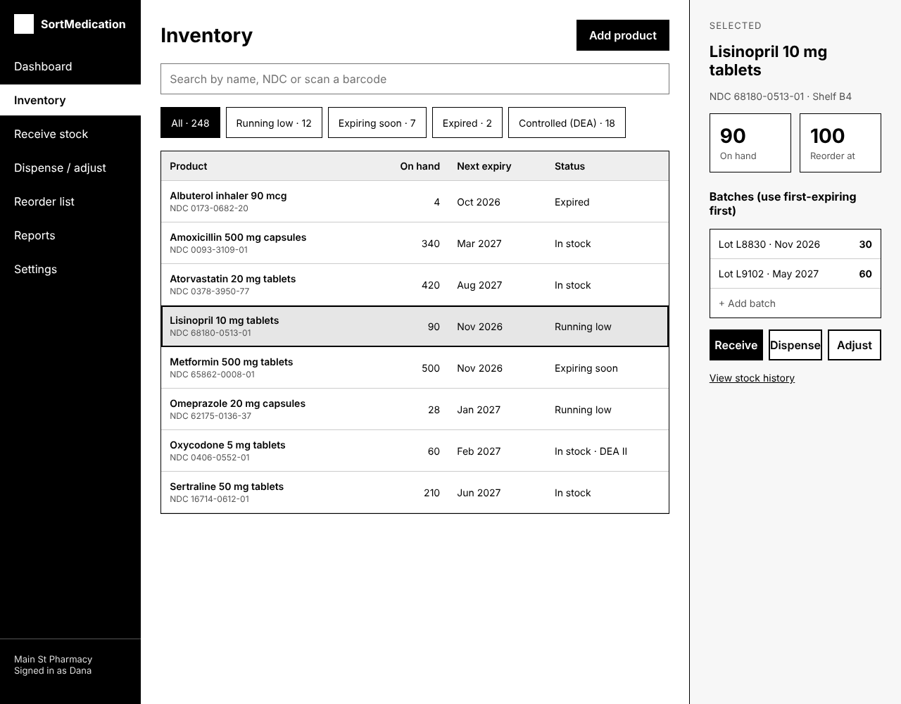

# Website wireframes

Low-detail sketches of how the SortMedication website will look, in black, white and grey.
They show layout only. Colours from `DESIGN.md` come later, and the medicines and numbers are examples.

This is the chosen direction: the home and sign-up pages from concept A, and the inventory screen from concept B.

| Page | Picture | Clickable page |
| --- | --- | --- |
| Home | [home.png](home.png) | [home.html](home.html) |
| Sign up | [sign-up.png](sign-up.png) | [sign-up.html](sign-up.html) |
| Inventory | [inventory.png](inventory.png) | [inventory.html](inventory.html) |

To click through, download the folder and open `home.html` in a browser:
**Start free trial**, then **Create account**, takes you to the inventory.

